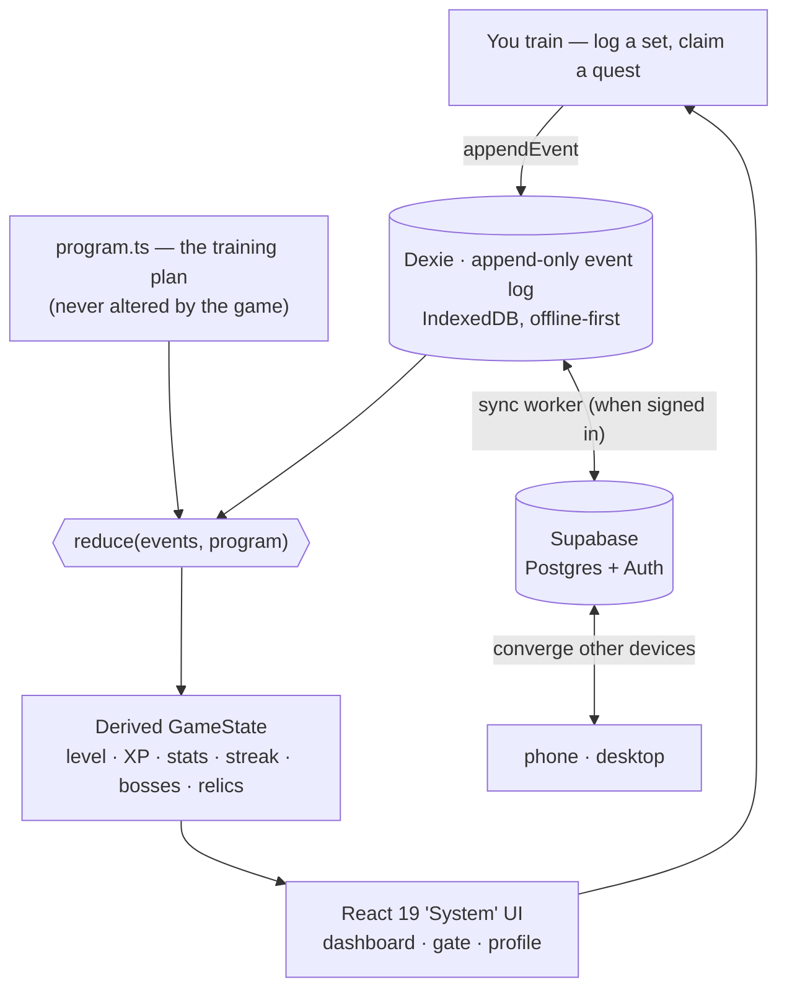

# ARISE

> **[THE SYSTEM HAS CHOSEN YOU.]**

A fitness RPG in which the character changes as the player gets stronger. Real training sessions
drive a 100-level progression from E-Rank nobody to Absolute Shadow Deity, inspired by
Solo Leveling. The app plays the role of "The System": a cold interface that issues quests,
tracks progress, and rewards progressive overload.

The rule underneath the fantasy is simple: the character only levels up when the player's real
lifts improve.

Arise succeeds **Shift + Lift**, a single-user offline workout PWA. It keeps shift-aware
programming, the muscle heatmap, double progression, and offline-first operation, then adds RPG
progression, accounts, and cross-device sync.

## How it works

The engine is **event-sourced**. Logging a set or claiming a quest appends an event to a local,
offline-first log. Level, XP, stats, streaks, bosses, and relics are derived by replaying that log
through a pure reducer. Game state is never stored or mutated directly, so the same event history
always produces the same character.



<sub>The **event log is the only source of truth**. Derived state is not synchronized. Devices
converge by replaying the synchronized events, and `appendEvent` is the only write path.</sub>

## Status

| Phase | Name | Status |
|---|---|---|
| 0 | Design & documentation | Complete |
| 1 | Foundation (engine, character, dashboard) | Complete (`v0.1.0`) |
| 2 | The Gate (workout tracking, XP, level-ups) | Complete (`v0.2.0`) |
| 3 | The System Awakens (quests, streaks, stats) | Complete (`v0.3.0`) |
| 4 | Ascension (auth, sync, multi-device) | Complete (`v0.4.0`) |
| 5 | Endgame (bosses, relics, polish, deploy) | Complete (`v0.5.0`) = v1 |
| 6 | Ascension Polish (System UI, assets, gym utilities) | Complete (`v0.6.0`) |

**The planned product features are complete.** The remaining work is content and operations:
generate the 100 character portraits (see [`docs/09-CHARACTER-CODEX.md`](docs/09-CHARACTER-CODEX.md)),
provision Supabase for live sync, and deploy ([`docs/06-DEPLOY.md`](docs/06-DEPLOY.md)). A how-to-use
guide is in [`docs/10-USER-GUIDE.md`](docs/10-USER-GUIDE.md).

## Features

- **Progression tied to training:** XP comes only from real outcomes: double progression, boss (PR)
  clears, streaks, recovery. No XP-per-rep, no currency, no energy, no decay.
- **The Gate:** a full workout flow per session (Push / Pull / Legs) with a live muscle
  heatmap, per-exercise form cues, and a one-tap set logger prefilled from last time.
- **Exercise demos:** each exercise shows a looping video clip when available and falls back to
  a procedural stick-figure animation. Both pause when not visible to save battery.
- **Bosses & relics:** milestone weights become derived PR "encounters"; named milestones mint
  permanent relics in a trophy case. Nothing earned can be lost (it's all re-derived).
- **System UI:** a holographic interface that changes color by tier, with a living void, glass panels,
  decode/shimmer effects), fully reduced-motion safe.
- **Offline-first PWA:** installs to the home screen, works fully offline (cold start
  included), and syncs across devices through Supabase when signed in.
- **Gym utilities:** rest timer, plate calculator + warm-ups, e1RM, bodyweight, measurements,
  and nutrition tracking with charts.

## Stack (summary)

React 19 + Vite + TypeScript PWA · Dexie (IndexedDB, offline-first event log) ·
Supabase (Postgres + Auth, sync) · deployed as a static PWA. Full rationale in the
[technical design doc](docs/03-TECHNICAL-DESIGN.md).

## Documentation

All design and build documentation lives in [`docs/`](docs/):

- [`00-HANDOFF.md`](docs/00-HANDOFF.md) — context handoff log; **read this first** when picking up the project, update it when finishing a phase
- [`01-PRD.md`](docs/01-PRD.md) — product requirements
- [`02-GDD.md`](docs/02-GDD.md) — game design document (XP, levels, tiers, quests, bosses)
- [`03-TECHNICAL-DESIGN.md`](docs/03-TECHNICAL-DESIGN.md) — stack, data model, sync, architecture
- [`04-DESIGN-SYSTEM.md`](docs/04-DESIGN-SYSTEM.md) — visual language, tokens, wireframes
- [`05-BUILD-PLAN.md`](docs/05-BUILD-PLAN.md) — phased build plan with files, models, and tests per phase
- [`06-DEPLOY.md`](docs/06-DEPLOY.md) — deploy & install · [`08-ASSETS.md`](docs/08-ASSETS.md) — asset generation guide · [`10-USER-GUIDE.md`](docs/10-USER-GUIDE.md) — how to use

## Develop

```bash
npm install
npm run dev          # local dev server
npm test             # engine unit tests (Vitest)
npm run build        # production build + service worker
```

## Character assets

The app is designed around a **tier manifest** (`tiers.json`) and convention-based image paths
(`assets/characters/lvl_NN.webp`). Images are generated separately and dropped in at any time;
until then a procedural aura placeholder renders for every level. The system is extensible
beyond level 100 by appending manifest entries without changing the code.

**Gate art** follows the same drop-in contract: place `assets/gates/<sessionId>.webp` and it
appears as the banner on the dashboard's gate panel and as the hero inside the gate. Until a
file exists, the slot stays hidden because the `Art` component handles a 404. Session IDs are
the keys of `SESSIONS` in `src/data/program.ts`.

## License

[MIT](LICENSE)
