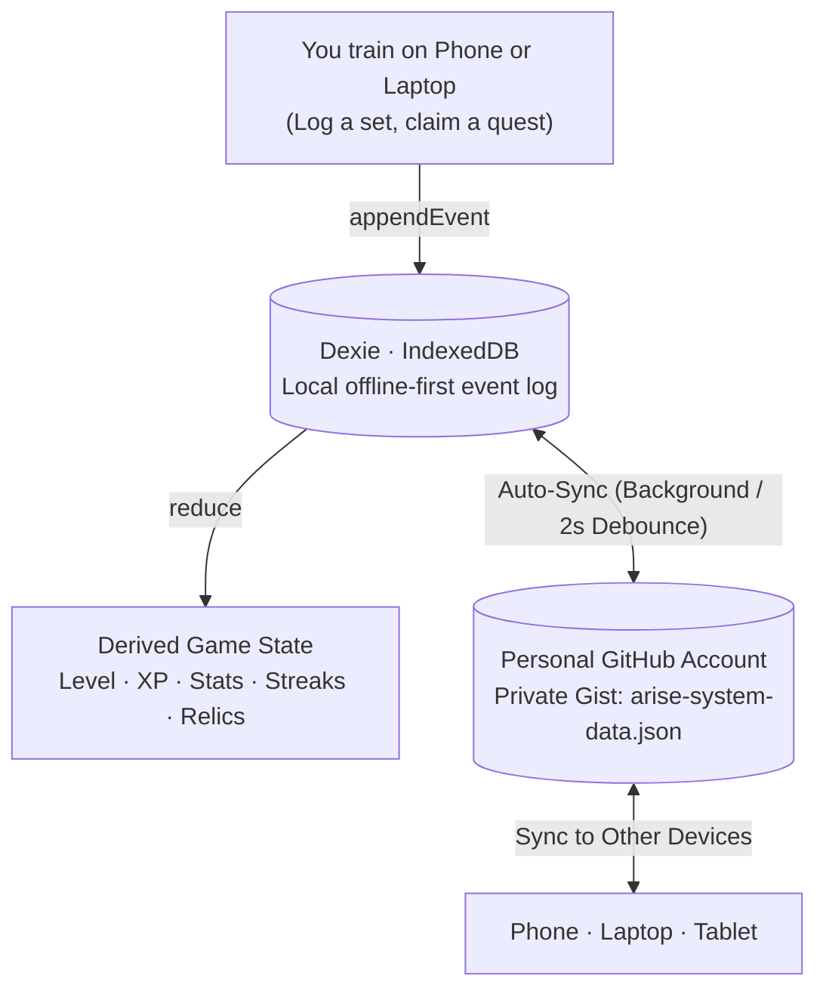

# ARISE — Solo Leveling Fitness RPG

> **[THE SYSTEM HAS CHOSEN YOU.]**

A fitness RPG in which the character changes as the player gets stronger. Real training sessions drive a 100-level progression from E-Rank nobody to Absolute Shadow Deity, inspired by *Solo Leveling*. The app plays the role of "The System": a cold interface that issues quests, tracks progress, and rewards progressive overload.

The rule underneath the fantasy is simple: **the character only levels up when the player's real lifts improve.**

---

## ⚡ Key Highlights

- **100% Free to Run Anywhere:** Runs completely static on GitHub Pages, Vercel, Netlify, or local preview. Zero server hosting costs.
- **Every User's Data Stored on GitHub:** No paid database or Supabase required. Users can link their personal GitHub account with a Personal Access Token (`gist` scope). All events, workouts, levels, and relics are automatically backed up and synchronized across phone and laptop via a private GitHub Gist.
- **Installable Mobile PWA:** Works on iPhone (iOS Safari "Add to Home Screen"), Android (1-tap native install prompt), and desktop. Works **100% offline** at the gym—even in basements without cell signal. Once reconnected, it transmits logs to GitHub.
- **All Original Features Intact:**
  - 100-level RPG progression (E-Rank to Absolute Shadow Deity)
  - The Gate: Push / Pull / Legs double progression training engine
  - Plate calculator & Warm-up calculator
  - Procedural skeleton stick figure animations + video exercise demos
  - Rest timer with audio & vibration feedback
  - Live anatomical muscle heatmap
  - Boss encounters & Relic trophy showcase
  - Quests & Streaks (Sanctuary rest days, daily workouts, PRs)
  - Bodyweight, measurements, and nutrition tracking with charts
  - Holographic System UI with tier-based aura color shifts and particle fields

---

## ☁️ GitHub Cloud Storage & Sync Engine

Arise uses an **event-sourced architecture**. Every set logged, quest claimed, or measurement recorded appends an immutable event with a UUIDv7 timestamp.



### How to Connect GitHub Sync:
1. Open **[SETTINGS]** in the app.
2. Under **GITHUB SYSTEM MATRIX**, click **[1-CLICK: GENERATE GITHUB TOKEN]** (opens GitHub with the `gist` permission pre-selected).
3. Generate the token, copy it, and paste it into Arise.
4. Click **[CONNECT GITHUB MATRIX]**.
5. The System automatically creates a secret Gist `arise-system-data.json`.
6. Whenever you train on your phone, changes automatically sync to GitHub. When you open Arise on your laptop, it pulls your latest progress and recalculates your level and stats immediately!
7. You also get full data sovereignty: manual JSON backup download and restore are built-in.

---

## 📲 Install as an App on Your Phone

Arise is a Progressive Web App (PWA):

- **On Android (Chrome / Edge / Brave):** Tap the **"INSTALL APP NOW"** button in the dashboard header or settings to install it with native app icon and full-screen experience.
- **On iPhone / iPad (Safari):**
  1. Open the web app in Safari.
  2. Tap the **Share** button (`⎋` box with arrow).
  3. Scroll down and tap **Add to Home Screen** (`⊞`).
  4. Tap **Add**.
- Once installed, the app launches without browser bars, plays offline, and caches all sound effects and character portraits.

---

## 🚀 How to Run & Deploy for Free

### 1. Local Development
```bash
npm install
npm run dev          # Start local dev server (default: http://localhost:5173)
npm test             # Run Vitest test suite (140 tests)
npm run build        # Production build + PWA service worker (dist/)
npm run preview      # Preview production build locally
```

### 2. Free Deployment to GitHub Pages
A pre-configured GitHub Actions workflow is included at `.github/workflows/deploy.yml`:
1. Push this code to your own GitHub repository (`git push origin main`).
2. In your GitHub repository settings:
   - Navigate to **Settings** -> **Pages**.
   - Under **Build and deployment** -> **Source**, select **GitHub Actions**.
3. Push any commit to `main`, and GitHub Actions will automatically build and publish your app at `https://<your-username>.github.io/<repo-name>/`!

### 3. Deploy to Vercel or Netlify (Alternative)
- Import the repo into [Vercel](https://vercel.com) or [Netlify](https://netlify.com).
- Build command: `npm run build`
- Output directory: `dist`
- 100% free tier.

---

## 🏛️ Character Codex & Assets

Character assets follow convention-based paths (`assets/characters/lvl_{nnn}.webp`) mapped by `tiers.json`. When an image file is not present, the app gracefully falls back to a procedural, tier-colored aura animation placeholder.

Gate banners and exercise demos similarly fall back to procedural graphics when media files are not found, ensuring zero broken icons or crashed screens.

---

## 📜 License

[MIT](LICENSE)
