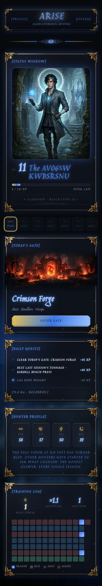
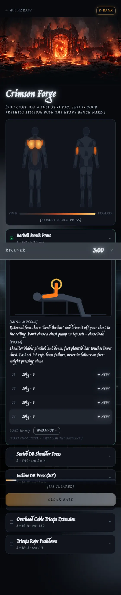
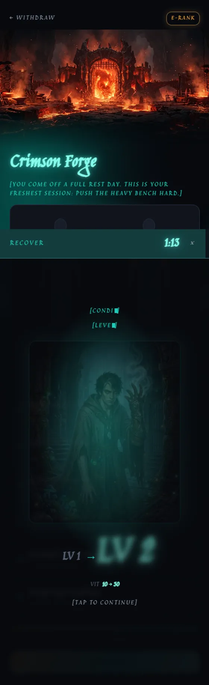
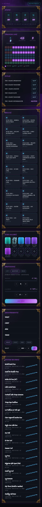
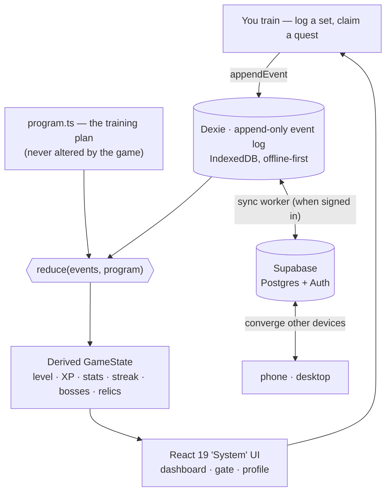

# ARISE

> **[THE SYSTEM HAS CHOSEN YOU.]**

A fitness RPG where your character's body is a mirror of your real one. Every real training
session feeds a 100-level evolution from E-Rank nobody to Absolute Shadow Deity, inspired by
Solo Leveling. The app is "The System": a cold, omniscient interface that issues quests,
measures you without flattery, and rewards only genuine progressive overload.

**Product truth under the fantasy:** the character can only level up if your real lifts go up,
so the only way to win the game is to actually get stronger.

<p align="center">
  
  
  
  
</p>
<p align="center"><sub>Dashboard · The Gate (workout) · Level-up ceremony · Profile — themes recolor per tier as you rank up.</sub></p>

Arise is the ground-up successor to **Shift + Lift** (a single-user offline workout PWA). It
keeps everything that app got right — shift-aware programming, the muscle heatmap, double
progression, offline-first discipline — and wraps it in an honest RPG progression layer with
accounts and cross-device sync.

## How it works

The engine is **event-sourced**: logging a set or claiming a quest only ever *appends an event*
to a local, offline-first log. Everything the game shows — your level, XP, stats, streak, bosses,
relics — is **derived** by replaying that log through a pure reducer. Nothing game-state is ever
stored or mutated directly, so it can't drift, and the same history always produces the same
character.



<sub>The **event log is the only source of truth**; the derived state never syncs — only the log
does, so devices converge by replaying the same events. `appendEvent` is the single write path.</sub>

## Status

| Phase | Name | Status |
|---|---|---|
| 0 | Design & documentation | Complete |
| 1 | Foundation (engine, character, dashboard) | Complete (`v0.1.0`) |
| 2 | The Gate (workout tracking, XP, level-ups) | Complete (`v0.2.0`) |
| 3 | The System Awakens (quests, streaks, stats) | Complete (`v0.3.0`) |
| 4 | Ascension (auth, sync, multi-device) | Complete (`v0.4.0`) |
| 5 | Endgame (bosses, relics, polish, deploy) | Complete (`v0.5.0`) = v1 |
| 6 | Ascension Polish (System UI, assets, gym utilities) | Complete (`v0.6.0`) |

**The build/feature plan is complete.** What remains is content + ops, not code:
generate the 100 character portraits (see [`docs/09-CHARACTER-CODEX.md`](docs/09-CHARACTER-CODEX.md)),
provision Supabase for live sync, and deploy ([`docs/06-DEPLOY.md`](docs/06-DEPLOY.md)). A how-to-use
guide is in [`docs/10-USER-GUIDE.md`](docs/10-USER-GUIDE.md).

## Features

- **Honest progression** — XP comes only from real outcomes: double progression, boss (PR)
  clears, streaks, recovery. No XP-per-rep, no currency, no energy, no decay.
- **The Gate** — a full workout flow per session (Push / Pull / Legs) with a live muscle
  heatmap, per-exercise form cues, and a one-tap set logger prefilled from last time.
- **Exercise demos** — each exercise shows a looping video clip when available, falling back to
  a procedural stick-figure animation — both gated on visibility for battery.
- **Bosses & relics** — milestone weights become derived PR "encounters"; named milestones mint
  permanent relics in a trophy case. Nothing earned can be lost (it's all re-derived).
- **System UI** — a holographic, per-tier-recoloring interface (living void, glass panels,
  decode/shimmer effects), fully reduced-motion safe.
- **Offline-first PWA** — installs to the home screen, works fully offline (cold start
  included), and syncs across devices through Supabase when signed in.
- **Gym utilities** — rest timer, plate calculator + warm-ups, e1RM, bodyweight, measurements,
  and nutrition tracking with charts.

## Stack (summary)

React 19 + Vite + TypeScript PWA · Dexie (IndexedDB, offline-first event log) ·
Supabase (Postgres + Auth, sync) · deployed as a static PWA. Full rationale in the
[technical design doc](docs/03-TECHNICAL-DESIGN.md).

## Documentation

All design and build documentation lives in [`docs/`](docs/):

- [`00-HANDOFF.md`](docs/00-HANDOFF.md) — context handoff log; **read this first** when picking up the project, update it when finishing a phase
- [`01-PRD.md`](docs/01-PRD.md) — product requirements
- [`02-GDD.md`](docs/02-GDD.md) — game design document (XP, levels, tiers, quests, bosses)
- [`03-TECHNICAL-DESIGN.md`](docs/03-TECHNICAL-DESIGN.md) — stack, data model, sync, architecture
- [`04-DESIGN-SYSTEM.md`](docs/04-DESIGN-SYSTEM.md) — visual language, tokens, wireframes
- [`05-BUILD-PLAN.md`](docs/05-BUILD-PLAN.md) — phased build plan with files, models, and tests per phase
- [`06-DEPLOY.md`](docs/06-DEPLOY.md) — deploy & install · [`08-ASSETS.md`](docs/08-ASSETS.md) — asset generation guide · [`10-USER-GUIDE.md`](docs/10-USER-GUIDE.md) — how to use

## Develop

```bash
npm install
npm run dev          # local dev server
npm test             # engine unit tests (Vitest)
npm run build        # production build + service worker
```

## Character assets

The app is designed around a **tier manifest** (`tiers.json`) and convention-based image paths
(`assets/characters/lvl_NN.webp`). Images are generated separately and dropped in at any time;
until then a procedural aura placeholder renders for every level. The system is extensible
beyond level 100 by appending manifest entries — no code changes.

**Gate art** follows the same drop-in contract: place `assets/gates/<sessionId>.webp` and it
appears as the banner on the dashboard's gate panel and as the hero inside the gate. Until a
file exists the slot is silently absent (the `Art` component hides itself on a 404) — no code
changes, no broken images. Session ids are the keys of `SESSIONS` in `src/data/program.ts`.

## License

[MIT](LICENSE)
